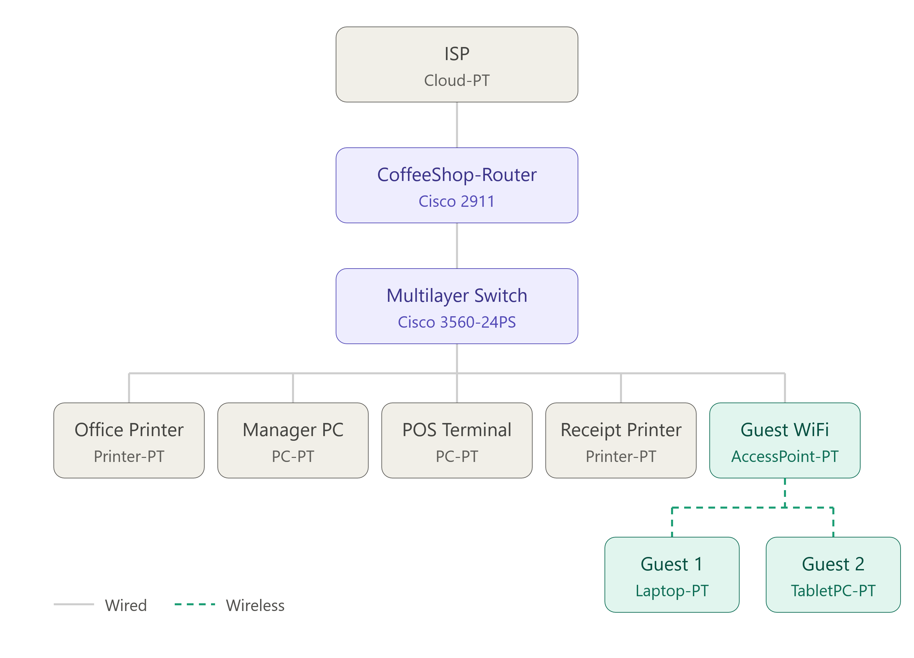

# ☕ Coffee Shop Network# 

## 🧱 Overview
A comprehensive small business network design for a local coffee shop, implemented in Cisco Packet Tracer. The project focuses on building a secure, segmented infrastructure from the ground up, tailored to the specific operational needs of a cafe environment. It features VLAN segmentation to isolate traffic across four distinct logical networks: Management Office, Point of Sale (POS), Guest Wi-Fi, and Network Management.

---

  

---

## ⚙️ Configuration Summary
- VLANs: Management Office (10), Point of Sale (20), Guest Wi-Fi (30), and Network Management (99).
- Inter-VLAN Routing: Router-on-a-Stick configuration using sub-interfaces on the router.
- Switching: Trunk port configured between router and switch; Access ports assigned with PortFast enabled on end-device         interfaces.
- DHCP: Router-based DHCP server with distinct pools for Management, POS, and Guest networks, including address reservation for infrastructure devices.
- Network Security: SSH configured for secure remote management; Standard ACLs applied inbound on the Guest Wi-Fi interface to prevent unauthorized access to internal subnets; Console port security enabled on network devices.
- Wireless: WPA2-protected Guest Wi-Fi network via wireless access point.

---

## 📁 Files
- `coffee shop network.pkt` — Full Packet Tracer topology
- `coffee-shop_network_topology.png` — Visual diagram
- `configs/` — Router, switch configuration files

---

## ✅ Verification
- Successful DHCP Assignment: Confirmed all end devices, including the guest laptop, successfully received IP addresses from the router-based DHCP pools.
- Connectivity Testing: Performed ping tests to verify connectivity to default gateways and communication between devices within the same and different VLANs.
- Inter-VLAN Routing: Verified inter-VLAN routing by successfully communicating with devices on the Point of Sale network from the management office.
- ACL Enforcement: Confirmed that the Access Control List correctly blocks guest Wi-Fi devices from accessing the internal management and Point of Sale subnets while still allowing internet connectivity.

---

## 🧠 Lessons Learned
Building this coffee shop network taught me that you have to prioritize keeping sensitive stuff like the point-of-sale system totally isolated from guest Wi-Fi, while making sure everything is still easy to manage down the road. It really hammered home how important it is to keep things organized with proper documentation and smart port planning, because if you don't do that upfront, you're going to have a nightmare trying to fix things later. At the end of the day, it's all about balancing security and usability so the network just works the way it's supposed to.

---

⬅️ <a href="../README.md">Back to Main Portfolio</a>
